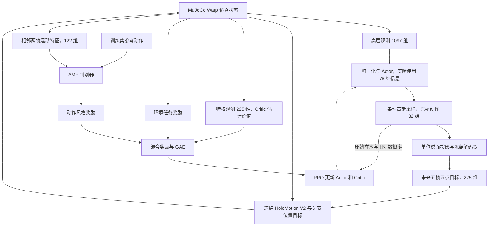

# HoloBoxing 仿真训练架构与源码导读

源码定位基于 HoloMotion 提交 `f52dd81ae935a828b0296f5ee0f833beb7378bf0`。官方教程中的三段训练依次是**动作表示、监督模仿、强化学习**。本项目第一阶段完成环境核查和源码验证。 [官方中文版教程](https://github.com/HorizonRobotics/HoloMotion/blob/f52dd81ae935a828b0296f5ee0f833beb7378bf0/holoboxing/README.zh-CN.md)

## 一次控制与学习如何衔接



高层每 20 ms 生成一次目标。冻结的底层控制器同时接收实际机器人状态，并通过独立的推理缓存跟踪目标。底层输出 29 个关节控制量，环境将它们换算成关节位置目标。每个高层步执行 4 个 5 ms 物理子步，然后读取新状态、任务奖励和终止标记。 [环境 `MujocoSandbagEnv.step()`](https://github.com/HorizonRobotics/HoloMotion/blob/f52dd81ae935a828b0296f5ee0f833beb7378bf0/holoboxing/training/envs/mujoco_env.py#L567) · [底层调用 `CommonLower._execute()`](https://github.com/HorizonRobotics/HoloMotion/blob/f52dd81ae935a828b0296f5ee0f833beb7378bf0/holoboxing/training/envs/control.py#L467)

## 观测、动作与价值

| 接口 | 形状 | 代码中的含义 |
| --- | --- | --- |
| 比赛高层输入 `obs` | `float32[1,1097]` | `[0:1080]` 为本方 10 帧、每帧 108 维的历史。 `[1080:1095]` 是对手五点的位置。最后两维是剩余时间和分差，参考 RL 环境填零。 |
| 参考 Actor 使用的字段 | 63 + 15 维 | `current_state` 使用 `[972:1035]` 的角速度、当前五点位姿和五点线速度，加上 `[1080:1095]`。当前帧里缓存的上一帧位姿和更早帧被置零。MLP 仍接收 1095 维向量，输出 32 维均值。 |
| Critic 的特权观测 | `[N,225] → [N,1]` | 14 个刚体相对躯干的位姿 126 维、根线速度和角速度 6 维、关节位置偏差/速度/上一控制量各 29 维、两手到对手躯干的相对位置 6 维。按角色估计混合奖励的状态价值。 |
| PPO 采样与存储 | `[N,32]` | `PPO.act()` 保存条件高斯的原始动作、旧对数概率和分布统计。时序相关探索默认 `exploration_rho=0.9`，因而还保存上一步观测、32 维探索上下文和模式标记。球面路线的 `horizon_rho=0.0`。 |
| 仿真高层动作与导出输出 `target_pose` | 训练 `[N,225]`，导出 `float32[1,225]` | 动作先投影成 32 维单位方向，再解码成 `[N,5,5,9]`。五个未来时刻为 20、40、60、80、100 ms，部位是骨盆、双腕、双踝。每个位姿用 3 维位置和旋转矩阵的 X、Z 两列表示，以当前骨盆为坐标系。 |

观测重组从 `_read()` 和 `reframe_c()` 入手。解码时 `MotionDecoder.forward()` 用 `project_xz()` 恢复有效旋转。运行时的批量 ONNX 由官方代码在输出目录派生，原始冻结包通过 SHA-256 校验后以只读输入接入。 [赛事接口](https://github.com/HorizonRobotics/HoloMotion/blob/f52dd81ae935a828b0296f5ee0f833beb7378bf0/holoboxing/README.zh-CN.md#策略接口) · [`_critic()`](https://github.com/HorizonRobotics/HoloMotion/blob/f52dd81ae935a828b0296f5ee0f833beb7378bf0/holoboxing/training/envs/mujoco_env.py#L312) · [`_read()`](https://github.com/HorizonRobotics/HoloMotion/blob/f52dd81ae935a828b0296f5ee0f833beb7378bf0/holoboxing/training/envs/mujoco_env.py#L349) · [`SphericalActor.latent()`](https://github.com/HorizonRobotics/HoloMotion/blob/f52dd81ae935a828b0296f5ee0f833beb7378bf0/holoboxing/training/spherical_actor.py#L52) · [`OnnxLower`](https://github.com/HorizonRobotics/HoloMotion/blob/f52dd81ae935a828b0296f5ee0f833beb7378bf0/holoboxing/training/envs/onnx_lower.py#L120)

## 从参考轨迹到可学习的规划器

1. **动作表示。** `prepare_prior.prepare()` 从源轨迹的正运动学生成未来五帧的 225 维位姿窗口。 `MotionPrior.encode()` 将参考窗口压成 32 维单位向量，解码器重建 225 维窗口。先验网络训练后按独立验证集重建误差保存 `best.pt`。 [参考窗口](https://github.com/HorizonRobotics/HoloMotion/blob/f52dd81ae935a828b0296f5ee0f833beb7378bf0/holoboxing/training/prepare_prior.py#L22) · [`MotionPrior`](https://github.com/HorizonRobotics/HoloMotion/blob/f52dd81ae935a828b0296f5ee0f833beb7378bf0/holoboxing/training/motion_prior.py#L72) · [`train_prior.train()`](https://github.com/HorizonRobotics/HoloMotion/blob/f52dd81ae935a828b0296f5ee0f833beb7378bf0/holoboxing/training/train_prior.py#L16)
2. **实测状态模仿。** `MeasuredCollector.collect()` 用冻结跟踪器执行源运动，采集实际仿真状态作为观测。未来参考目标相对于该时刻的实际骨盆表达。SL 只读取 InterHuman 的配对训练记录，以位姿误差训练规划器，梯度经解码器传回 Actor。解码器已冻结。检查点同时保存 Actor、解码器和观测归一化统计。 [实测采集](https://github.com/HorizonRobotics/HoloMotion/blob/f52dd81ae935a828b0296f5ee0f833beb7378bf0/holoboxing/data/collection.py#L150) · [训练样本 `Records`](https://github.com/HorizonRobotics/HoloMotion/blob/f52dd81ae935a828b0296f5ee0f833beb7378bf0/holoboxing/training/supervised/data.py#L12) · [`fit_statistics()` 与 `normalized_loss()`](https://github.com/HorizonRobotics/HoloMotion/blob/f52dd81ae935a828b0296f5ee0f833beb7378bf0/holoboxing/training/supervised/statistics.py#L40) · [SL `train()`](https://github.com/HorizonRobotics/HoloMotion/blob/f52dd81ae935a828b0296f5ee0f833beb7378bf0/holoboxing/training/supervised/training.py#L175)
3. **仿真 RL。** `train_rl.main()` 解析配置和初始化检查点，`train_mujoco.train()` 接上环境、AMP 参考数据和 runner。 `OnPolicyRunner.collect()` 收集完整 rollout 后，`PPO.update()` 更新学习方的 Actor、探索尺度和 Critic，再更新 AMP 判别器。底层控制器与解码器通过官方检查保持冻结。 [RL 入口](https://github.com/HorizonRobotics/HoloMotion/blob/f52dd81ae935a828b0296f5ee0f833beb7378bf0/holoboxing/training/train_rl.py#L17) · [装配环境](https://github.com/HorizonRobotics/HoloMotion/blob/f52dd81ae935a828b0296f5ee0f833beb7378bf0/holoboxing/training/scripts/train_mujoco.py#L19) · [`collect()`](https://github.com/HorizonRobotics/HoloMotion/blob/f52dd81ae935a828b0296f5ee0f833beb7378bf0/holoboxing/training/rsl_rl/runners/on_policy_runner.py#L359) · [`PPO.update()`](https://github.com/HorizonRobotics/HoloMotion/blob/f52dd81ae935a828b0296f5ee0f833beb7378bf0/holoboxing/training/rsl_rl/algorithms/ppo.py#L334)

## 奖励、GAE 与 PPO Loss

**AMP 先产生风格奖励。** 单帧特征由机体坐标下的根部角速度 3 维、相对名义值的关节角 29 维、关节速度 29 维组成。两帧按 50 Hz 配对成 122 维。参考样本来自 InterHuman 与 RoboStriker 的训练划分，特征归一化只用这些样本拟合。判别器将参考样本作为正类，将当前策略和 replay 中的仿真样本作为负类，通过 BCE、输出层权重正则和示范梯度惩罚训练。位姿解码器负责目标表示，AMP 判别器负责评价执行出来的运动。 [`amp_frame()` 和 `load_amp_motions()`](https://github.com/HorizonRobotics/HoloMotion/blob/f52dd81ae935a828b0296f5ee0f833beb7378bf0/holoboxing/training/rsl_rl/modules/amp.py#L53) · [`AMP.reward()` 与 `AMP.loss()`](https://github.com/HorizonRobotics/HoloMotion/blob/f52dd81ae935a828b0296f5ee0f833beb7378bf0/holoboxing/training/rsl_rl/modules/amp.py#L209) · [AMP 原著](https://xbpeng.github.io/projects/AMP/)

```text
style_reward = -0.1 * log(max(1 - sigmoid(discriminator_logit), 0.0001))
reward = 0.8 * task_reward + 0.2 * style_reward
```

**GAE 为每一步估计优势。** 用价值网络预测的 `V_t` 计算一步 TD 残差，然后沿同一 rollout 倒序累计。 `m_t = 1 - done_t` 关闭跨终止状态的递推。时间截断时，runner 先将 `gamma * V(实际截断状态)` 加入奖励，再按 `done` 切断递推。非有限样本被标记无效，优势在有效样本中标准化。 `R_t` 使用标准化之前的优势。 [截断处理](https://github.com/HorizonRobotics/HoloMotion/blob/f52dd81ae935a828b0296f5ee0f833beb7378bf0/holoboxing/training/rsl_rl/runners/on_policy_runner.py#L410) · [`RolloutStorage.compute_returns()`](https://github.com/HorizonRobotics/HoloMotion/blob/f52dd81ae935a828b0296f5ee0f833beb7378bf0/holoboxing/training/rsl_rl/storage/rollout_storage.py#L124) · [GAE 原著](https://arxiv.org/abs/1506.02438)

```text
delta_t = reward_t + gamma * m_t * V_(t+1) - V_t
A_t = delta_t + gamma * lambda * m_t * A_(t+1)
R_t = A_t + V_t
gamma = 0.99, lambda = 0.95
```

**PPO 复用同一批原始样本比较新旧策略。** `ratio` 由新旧策略对同一个 32 维原始动作的联合对数概率得到。策略项限制优势驱动的新旧概率比变化，价值项对新价值也做裁剪，熵项鼓励探索。每个学习角色按 KL 调整学习率，更新前还会复查采样时的概率一致性。 [采样 `PPO.act()`](https://github.com/HorizonRobotics/HoloMotion/blob/f52dd81ae935a828b0296f5ee0f833beb7378bf0/holoboxing/training/rsl_rl/algorithms/ppo.py#L137) · [损失 `PPO._role_loss()`](https://github.com/HorizonRobotics/HoloMotion/blob/f52dd81ae935a828b0296f5ee0f833beb7378bf0/holoboxing/training/rsl_rl/algorithms/ppo.py#L262) · [PPO 原著](https://arxiv.org/abs/1707.06347)

```text
ratio = exp(logp_new(u_raw) - logp_old(u_raw))
policy_loss = mean(max(-A_normalized * ratio, -A_normalized * clip(ratio, 0.8, 1.2)))
V_clipped = V_old + clip(V_new - V_old, -0.2, 0.2)
value_loss = mean(max((V_new - R)^2, (V_clipped - R)^2))
ppo_loss = policy_loss + 1.0 * value_loss - 0.005 * entropy
```

## 站立预热、自博弈与导出

| 训练入口参数 | 行为 |
| --- | --- |
| `--training-mode standing --supervised-checkpoint ...` | 用 SL 权重与统计初始化。对手保持世界坐标下的站立目标，只有 `ego` 贡献 PPO 与 AMP 的在线样本。 |
| `--training-mode selfplay --policy-checkpoint ...` | 开启新阶段，继承预热 Actor 和归一化统计，重新初始化 Critic、优化器、AMP 与对手池。对手使用 Actor 与统计的冻结快照。到刷新边界时加入当前快照、抽取对手并重置物理回合与历史。 |
| `--training-mode paired` | 两个角色分别学习，这是代码的默认模式。教程的预热和自博弈命令均显式选择模式。 |
| `--resume ...` | 从同阶段检查点恢复学习状态和对手池，物理回合从重置后开始。 `--updates` 指额外完成的更新数。 |

教程的自博弈阶段运行 128 次更新，刷新间隔也为 128，所以示例运行期间使用首个快照。 `OpponentPool.prepare()` 在延长运行后的更新边界才会加入新快照。导出使用高层 Actor 的确定性输出，模型中包含观测归一化和解码器，CPU 上用 ONNX Runtime 检查与 PyTorch 的输出一致性。 [阶段初始化](https://github.com/HorizonRobotics/HoloMotion/blob/f52dd81ae935a828b0296f5ee0f833beb7378bf0/holoboxing/training/rsl_rl/runners/on_policy_runner.py#L275) · [对手池](https://github.com/HorizonRobotics/HoloMotion/blob/f52dd81ae935a828b0296f5ee0f833beb7378bf0/holoboxing/training/opponent_pool.py#L56) · [`export_policy()`](https://github.com/HorizonRobotics/HoloMotion/blob/f52dd81ae935a828b0296f5ee0f833beb7378bf0/holoboxing/training/export.py#L151)

## 建议阅读顺序

1. 从 `mujoco_env.py` 的 `_read()`、`_critic()`、`step()` 跟踪同一个控制步，分别记下 1097、225、122 维张量的来源。
2. 对照 `spherical_actor.py` 的 `latent()`、`spherical_rl.py` 的 `execute()` 与 `ppo.py` 的 `act()`，核对存储动作与仿真动作的形状。
3. 从 `on_policy_runner.py` 的 `collect()` 追到 `rollout_storage.py` 的 `compute_returns()` 和 `ppo.py` 的 `_role_loss()`，观察奖励、优势和回报何时生成。
4. 将 `prepare_prior.py` 的源参考窗口与 `data/collection.py` 的实测记录对照，再沿 `train_sl.py`、`initialize_from_supervised()`、`initialize_from_policy()` 看清每个检查点的用途。
